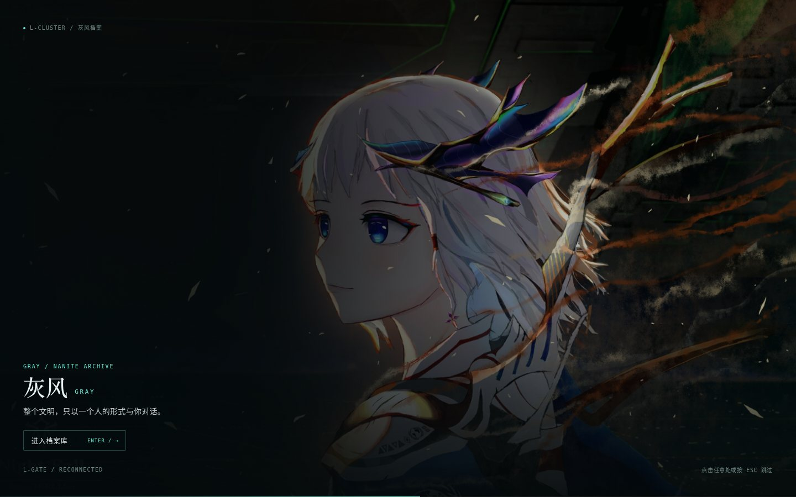
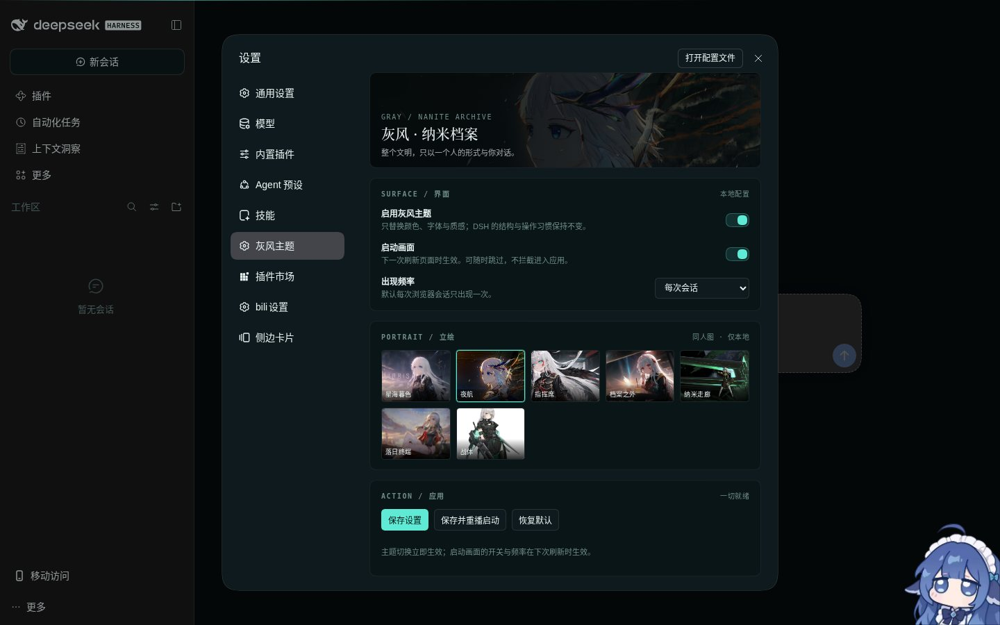

# 灰风 · 纳米档案 / GRAY: NANITE ARCHIVE

> 为 **DeepSeek Harness（DSH）** 制作的《群星》灰风（Gray）主题 + 可选启动画面。  
> 当前版本：**v0.1.0，可安装插件**；已在独立测试 profile 中完成端到端加载验证。

灰风是《群星：遥远星辰》L 星团事件链中的纳米文明意识体。在另一种可能的结局里，人们叫这个文明“灰蛊风暴”；而她最终选择以单一实体的形态存在。这个主题假设：**如果她选择以一套工作界面作为形态，会是什么样子。**



---

## 现在有什么

- **主题**：深空黑 / 银灰 / 纳米青，完整支持 Light / Dark / System；不覆盖 DSH 的明暗偏好。
- **启动画面**：3.6 秒的安静封面（不使用超大标题），默认每次浏览器会话一次；点击 / Enter / Esc 跳过；无密码、无自动声音、9 秒硬放行。
- **设置面板**：主题开关、启动开关、出现频率、7 张立绘、保存并重播、恢复默认。
- **本地配置**：`$DSH_HOME/dsh-gray-theme.json`。
- **素材库**：`assets/reference/` 中有 35 张研究/展示用图；主题包内置 7 张立绘与 3 张舰船/设定图。



## 安装

要求 DSH `0.2.1-rc.4` 或兼容版本。

```bash
# 在项目根目录
dsh plugin --profile web add ./dsh-gray-theme-0.1.0.tgz

# 再把 "dsh-gray-theme" 加入 ~/.dsh/profiles/web/package.json
# 的 dsh.profile.bundles 数组末尾，然后重启 dsh web。
```

`dsh plugin add` 只写依赖；**必须**同时修改 `dsh.profile.bundles`，否则插件会静默不生效。也可以直接运行 `./install.sh`（会检查 profile 是否可写并提示）。

安装后进入 **设置 → 灰风主题**。想强制重播启动画面，在设置里点 **保存并重播启动**。

> **当前沙箱限制**：根文件系统当前为只读（`/` 挂载为 `ro`），`~/.dsh/profiles/web` 无法写入，所以 3080 的现有实例尚未安装本插件。已在一个独立的可写测试 home 中启动 DSH Web 并验证：启动画面、跳过、会话跳过、主题 token、明暗切换、设置面板、开关保存、移动端布局。恢复 profile 写权限后运行 `install.sh` 即可。

## 设计与实现

**深空黑与银灰的档案页，青色只标记“活着的连接”。**

- 底色：`#070C0E` — `#132327`，不是纯黑，保留深海/舰内的冷。
- 主文字：银白 `#E7F1F0`，次要雾银 `#A7BEBC`，三级钢灰 `#6F8B89`。
- 信号：纳米青 `#5EEAD4` / 冷光青 `#7FF7EA`，只用于焦点、连接、进度、激活态。
- 例外色：静默红 `#E07A7A` 只给错误与“风暴形态”；暖琥珀 `#E8B86A` 只作环境暖光/警告。
- 字体：中文标题宋体，正文系统字体，英文标签等宽字；启动页标题控制在 40px 以内，应用内不使用巨型标题。
- 角色只在启动页与设置页出现，不遮挡工作区。

技术判断：

1. **不抢 DSH 的明暗偏好**：`ctx.theme.overrideTokens()` 叠加 `--dsw-alias-*`；不调用 `setTheme`。
2. **令牌不够才上 CSS**：纹理、焦点、滚动条、设置面板用作用域 CSS；不改布局。
3. **首屏无闪烁**：Host 通过 `tapIndex` 在首屏前注入关键底色、启动 HTML 与配置。
4. **启动是可选项**：可关闭、可跳过、有硬放行；不做密码/音频门槛。
5. **持久化独立**：配置写入 `$DSH_HOME/dsh-gray-theme.json`，不碰 DSH 内部 settings schema。

## 目录

```
dsh_Gray_wife/
├── dsh-gray-theme/            # 可安装插件源码
│   ├── lib/
│   │   ├── index.js           # Host：路由、注入、配置
│   │   ├── client.js          # Client：token、设置面板
│   │   ├── splash.js          # 启动交互
│   │   ├── splash.css
│   │   ├── theme.css
│   │   └── assets/            # 内置立绘
│   ├── docs/                  # 启动/设置/浅色截图
│   ├── package.json
│   ├── cordis.patch.yml
│   └── README.md
├── 计划书.md                  # 设定、视觉系统、架构与里程碑
├── moodboard.html             # 可交互视觉方向板
├── 素材索引.md                # 35 张图来源、尺寸、授权边界
├── install.sh                 # 安装脚本（含 profile 可写检查）
├── docs/                      # 情绪板预览
├── assets/reference/          # 研究/展示素材库
└── notes/                     # 萌娘百科与参考项目留档
```

## 素材与声明

- 本项目是**非商业同人企划**，与 Paradox Interactive 无关。
- 《群星》及其视觉素材版权归 Paradox Interactive 所有。
- 人物立绘来自社区同人创作，版权归原作者；仅用于本地主题展示，不构成再授权。若权利人要求，请移除对应文件。
- 参考图作者包括 EAGERLLIER / “Night Fall”、Yigelie▫（百度贴吧，2019），以及 Bilibili 文章/视频作者；明细见 [素材索引.md](素材索引.md)。
- 参考项目 [`dsh-startup-secret`](https://github.com/huzhengcai471-crypto/dsh-startup-secret) 仅用于工程结构与交互节奏研究；未复制其代码、文案、音频、徽记或立绘。
