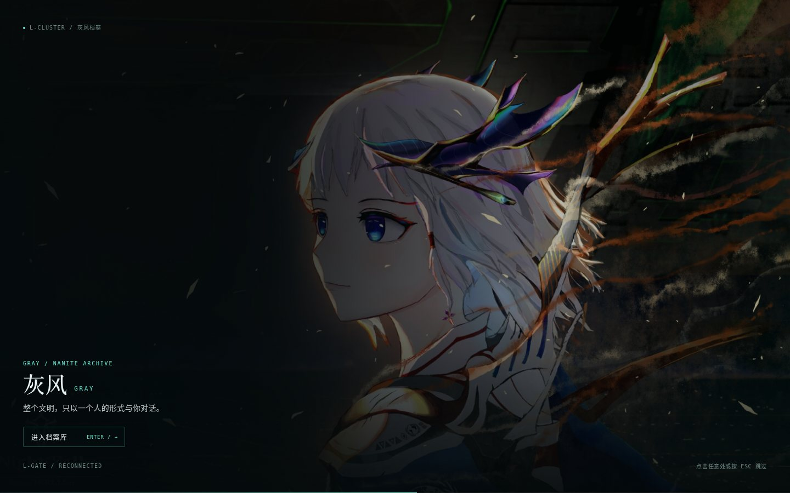
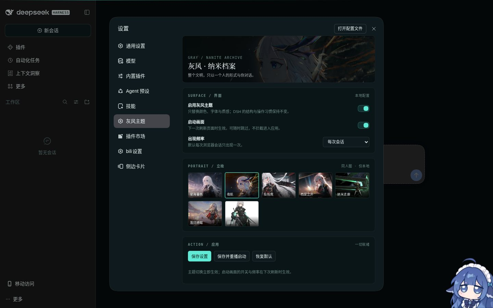

# dsh-gray-theme · 灰风 · 纳米档案

给 DeepSeek Harness Web 的一套极简《群星》灰风（Gray）主题 + 可选启动画面。





## 特性

- **两套配色**：深空黑/银灰/纳米青；浅色为雾白/深青。跟随 DSH 的 Light / Dark / System，不抢用户偏好。
- **令牌叠加**：通过 `ctx.theme.overrideTokens()` 覆盖 `--dsw-alias-*`；不调用 `setTheme`，不改 DSH 布局。
- **可选启动画面**：默认每次浏览器会话一次，3.6 秒；安静封面，标题 ≤ 40px；点击、Enter、Esc 可跳过；9 秒硬放行；无密码、无自动声音。
- **七张立绘**：Nightfall / 指挥席 / 星海暮色 / 档案之外 / 纳米走廊 / 落日终端 / 战形。设置面板内切换。
- **本地设置**：`$DSH_HOME/dsh-gray-theme.json`；支持主题开关、启动开关、出现频率、立绘、立即重播与恢复默认。

## 安装

要求 DSH `0.2.1-rc.4` 或兼容版本。

```bash
# 1. 安装本地包
dsh plugin --profile web add /absolute/path/dsh-gray-theme-0.1.0.tgz

# 2. 把包名加入 profile 的 bundle 列表
#    编辑 ~/.dsh/profiles/web/package.json，在 dsh.profile.bundles 末尾添加：
#    "dsh-gray-theme"

# 3. 重启 dsh web
```

> `dsh plugin add` 只写依赖，不会自动加入 `dsh.profile.bundles`；缺少这一步插件会静默不生效。

如果当前环境无法写入 profile（例如根文件系统为只读），需要先恢复 `~/.dsh` 的写权限，或把 profile 放到可写目录并以 `DSH_HOME` 指向它。

## 使用

重启后打开 DSH，进入 **设置 → 灰风主题**：

- **启用灰风主题**：立即切换令牌；关闭后回到 DSH 默认 Light/Dark。
- **启动画面**：下一次刷新页面时生效。
- **出现频率**：每次会话 / 每天一次 / 每次刷新。
- **保存并重播启动**：保存、清空本会话标记并重载。
- **恢复默认**：回到深色、Nightfall、每次会话。

想强制重播启动画面，在设置里点 **保存并重播启动**。

## 配置

```json
{
  "enabled": true,
  "boot": true,
  "mode": "session",
  "portrait": "nightfall",
  "duration": 3600
}
```

`mode`: `session` | `daily` | `always`。`portrait`: `nightfall` | `command` | `dusk` | `bar` | `corridor` | `seated` | `warform`。

## 结构

```
lib/index.js      Host：路由、tapIndex 注入、配置读写
lib/client.js     Client：token 覆盖、设置面板
lib/splash.js     启动画面交互与跳过
lib/splash.css    启动画面样式
lib/theme.css     档案纹理、字体、焦点、滚动条、响应式设置面板
lib/assets/       内置立绘与舰船图
```

## 素材与声明

本包是非商业同人作品，与 Paradox Interactive 无关。《群星》及游戏素材版权归 Paradox Interactive。人物立绘来自社区同人创作，版权归原作者；仅用于本主题包的本地展示。若权利人要求，请移除对应文件。

参考项目 [`dsh-startup-secret`](https://github.com/huzhengcai471-crypto/dsh-startup-secret) 仅用于工程结构参考；未复制其代码、文案、音频或徽记。
